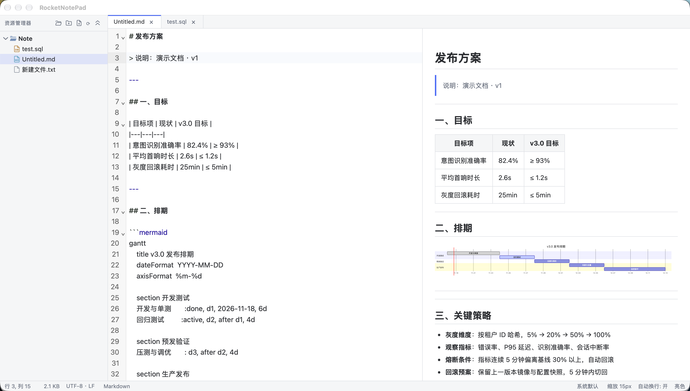
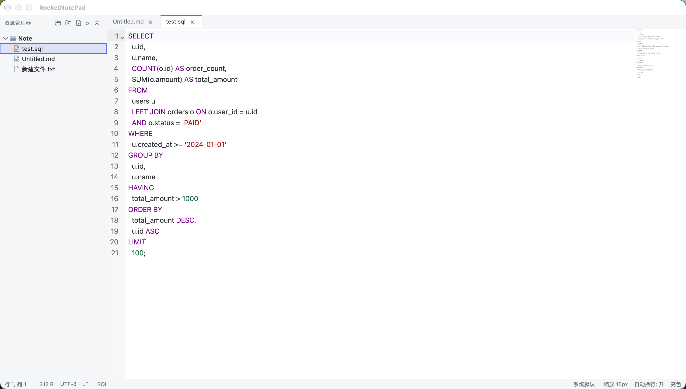
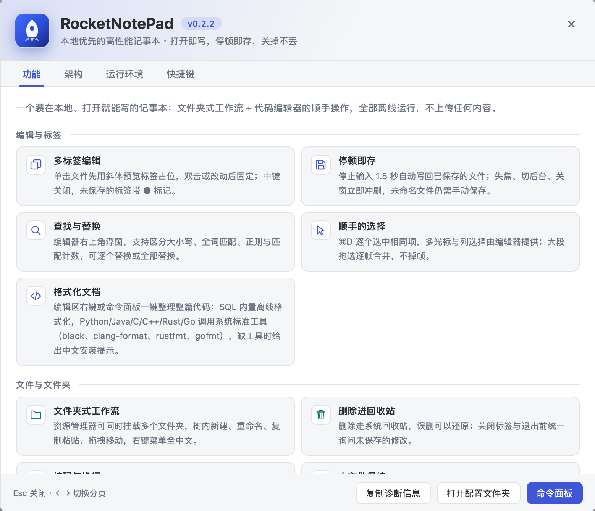
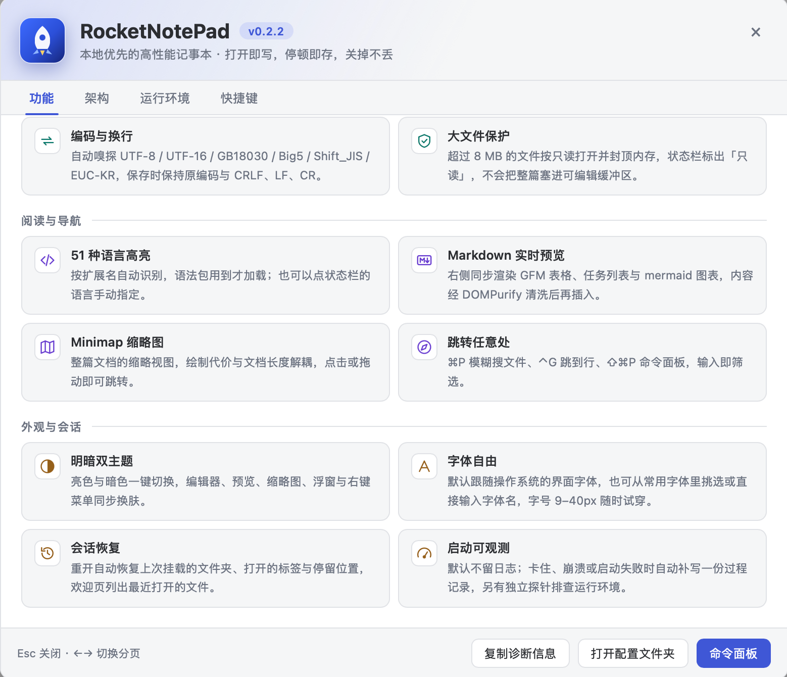

# RocketNotePad

低资源占用的本地笔记 / 代码编辑器，交互类似VSCode。
技术栈：**Rust + Tauri 2 + CodeMirror 6**（TypeScript / Vite），原生支持 **macOS**（Apple Silicon / Intel）、**Windows 10+** 与 **Ubuntu 22.04+（x86_64，deb / AppImage）**。

不登录、不联网、不上传：所有文件操作都发生在本机磁盘上。

## 功能亮点

**编辑与标签**

- 多标签编辑：单击预览、双击固定，中键关闭，`Cmd+Shift+W` 一键关闭所有标签（未保存统一询问），未保存标签带 `●` 标记
- 停顿即存：停止输入 1.5 秒自动写回已保存的文件；失焦、切后台、关窗立即冲刷
- VS Code 风格查找替换浮窗：区分大小写、全词、正则、匹配计数、全部替换
- `Cmd+D` 逐个选中相同项，多光标与列选择，大段拖选逐帧合并、不掉帧
- 右键一键格式化：SQL 内置离线格式化；Python / Java / C / C++ / Rust / Go 调用系统标准工具（black、clang-format、rustfmt、gofmt）

**语法高亮与预览**

- 50+ 种语言的语法高亮，按扩展名自动识别；语法包按需动态加载，不拖慢启动
- Markdown 右侧实时预览：GFM 表格、任务列表、代码高亮与 mermaid 图表，内容经 DOMPurify 清洗
- Minimap 缩略图：绘制代价与文档长度解耦，点击或拖动即可跳转

**文件与文件夹**

- 文件夹式工作流：可同时挂载多个文件夹，树内新建、重命名、复制粘贴、拖拽移动，右键菜单全中文
- 删除走系统回收站，误删可还原；退出前统一询问未保存的修改
- 自动嗅探 UTF-8 / UTF-16 / GB18030 / Big5 / Shift_JIS / EUC-KR，保存时保持原编码与换行风格
- 大文件三档：默认 ≤64 MB 可编辑、64–256 MB 只读、>256 MB 拒绝；设置菜单「可编辑上限 / 只读上限」可调，写入配置文件

**外观与会话**

- 明暗双主题一键切换；字体默认跟随系统，也可自选，字号 9–40px
- 会话恢复：重开自动恢复上次挂载的文件夹、打开的标签与光标位置
- Sublime 风格原生菜单栏 + `Cmd+P` 跳转任意文件、`Cmd+Shift+P` 命令面板

## 界面预览

**Markdown 编辑 + 实时预览**（GFM 表格、mermaid 甘特图同步渲染）：



**SQL 语法高亮**（51 种语言按需加载）：



**关于面板 · 功能总览**：





## 系统要求

| 平台 | 要求 |
|------|------|
| macOS | Apple Silicon 或 Intel（分别提供 aarch64 / x64 安装包，另附 universal 通用包） |
| Windows | Windows 10 1803 及以上 / Windows 11 / Windows Server 2019+（x64），需 [WebView2 Runtime](https://developer.microsoft.com/microsoft-edge/webview2/)（较新系统已内置，安装包会自动引导下载） |
| Linux | Ubuntu 22.04 及以上（x86_64），deb / AppImage，依赖 WebKitGTK 4.1（deb 会自动装依赖） |

## 下载安装

到 [Releases](https://github.com/AIWishCoding/RocketNotePad/releases) 页面下载：

- `RocketNotePad_x.x.x_aarch64.dmg` — macOS（Apple Silicon）
- `RocketNotePad_x.x.x_x64.dmg` — macOS（Intel 芯片）
- `RocketNotePad_x.x.x_universal.dmg` — macOS 通用包（两种芯片皆可，不确定芯片时选它）
- `RocketNotePad_x.x.x_x64-setup.exe` — Windows 安装程序
- `RocketNotePad_x.x.x_amd64.deb` — Ubuntu / Debian（x86_64）
- `RocketNotePad_x.x.x_amd64.AppImage` — Linux 通用免安装（x86_64）

> 本应用未做 Apple 公证。若首次打开被 macOS 拦截提示「文件已损坏」，在终端执行：
>
> ```bash
> xattr -dr com.apple.quarantine /Applications/RocketNotePad.app
> ```

## 从源码构建

### 环境准备

- Rust stable（≥ 1.82，通过 [rustup](https://rustup.rs) 安装）
- Node.js ≥ 20（推荐 22）
- macOS：Xcode Command Line Tools；Windows：VS 2022 C++ Build Tools

### 开发调试（前端热重载）

```bash
npm install
npm run tauri dev
```

### 打包产物

```bash
# macOS（.app 与 .dmg，位于 src-tauri/target/release/bundle/）
npm run tauri build

# macOS Intel 包（x64 dmg）
npm run tauri build -- --target x86_64-apple-darwin --bundles dmg

# macOS universal 包
npm run tauri build -- --target universal-apple-darwin

# Windows 安装包（.exe，位于 src-tauri/target/release/bundle/nsis/）
npm run tauri build

# Linux（需 Linux 主机；deb 与 AppImage，CI 在打 tag 时自动产出并挂到 Release）
npm run tauri build -- --bundles deb,appimage
```

在 macOS 上交叉打包 Windows 产物需 `cargo-xwin`，详见 [BUILD.md](BUILD.md)。

### 运行测试

```bash
npm run test:types   # TypeScript 类型检查（src + tests）
npm run test         # 前端单元与端到端测试（vitest + jsdom）
npm run test:rust    # 后端文件层测试（cargo test）
npm run test:all     # 全量
```

CI 由 GitHub Actions 承担：`push` 到 master 与 PR 跑全量测试（test.yml），打 `v*` 标签或手动触发跑双平台打包（build.yml）。

## 项目结构

```text
├── src/                  前端（TypeScript + CodeMirror 6）
│   ├── main.ts           应用装配与命令接线
│   ├── editor.ts         编辑器封装（高亮/多光标/查找替换）
│   ├── languages.ts      50+ 语言注册与按需加载
│   ├── preview.ts        Markdown 实时预览（GFM + mermaid）
│   ├── sidebar.ts        资源管理器（多文件夹树 / 右键菜单）
│   ├── about.ts          关于面板（功能/架构/环境/快捷键）
│   └── ...
├── src-tauri/            后端（Rust）
│   └── src/              文件层：读写、编码嗅探、大文件保护、格式化、启动日志
├── probe/                零依赖启动探针（独立 crate，用于排查环境问题）
├── docs/screenshots/     README 界面预览截图
├── tests/
│   ├── unit/             前端单元测试
│   └── e2e/              应用级端到端测试（jsdom 内模拟 Tauri 宿主）
├── .github/workflows/    CI：测试 + 双平台打包
├── vite.config.ts        前端构建配置
└── BUILD.md              构建、打包与故障排查完全指南
```

## 设计取向

- **低资源占用**：Tauri 2 用系统 WebView 替代捆绑 Chromium，安装包约 5 MB、常驻内存远低于 Electron 系编辑器
- **语言包按需加载**：语法定义拆为动态分包，首屏只装基础运行时，打开什么语言加载什么包，加载失败自动降级为纯文本且下次可重试
- **配置就近持久化**：macOS 存于 `~/.rocketnote/`；Windows 存于 exe 同目录，绿色可携带
- **启动可观测**：默认不留日志；启动卡住或崩溃时自动补写一份过程记录，另附独立探针可交叉验证运行环境

## 版本

当前版本 **0.2.6**。版本号同步维护于 `package.json`、`src-tauri/Cargo.toml` 与 `src-tauri/tauri.conf.json`，由测试保证三处一致。

## 许可

本项目基于 [Apache License 2.0](LICENSE) 开源发布，Copyright 2026 maple。

## 关注公众号

欢迎关注微信公众号，获取版本更新与新功能动态：


